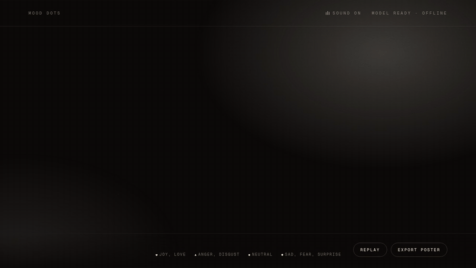

# Mood Dots



Write a sentence and its dots change shape to match its mood. Hearts for joy, triangles for anger, squares for flat facts.

It's set in [Geist Serif](https://vercel.com/blog/introducing-geist-serif), which Vercel released on 30 October 2026. The font has an `ELSH` (element shape) axis that redraws every dot in the typeface: the dots on i and j, full stops, commas, colons. Mood Dots ties that axis to an emotion model running in your browser.

Live: https://mood-dots.vercel.app

## How it works

1. You type into a normal text box. A copy of your text sits on top of it, split into sentences, so each sentence can carry its own font setting while the caret behaves as usual.
2. When a sentence ends with `.`, `!` or `?` and you pause for a moment, a small emotion model reads it. It runs in the page with transformers.js. Your text never leaves your device.
3. The sentence's dots shrink, switch to the new shape and pop back with a glow and a few sparks in the mood's colour. The axis value snaps rather than animates, because the values in between are other shapes.
4. The background drifts toward the colour of the latest mood, and a row of shaped dots along the bottom records every sentence.

**Replay** retypes your text at a human pace so you can screen-record it. **Export poster** saves a 1080×1350 PNG.

## Mood to shape

| Mood (model label) | Shape | `ELSH` value |
| --- | --- | --- |
| joy | heart | 100 |
| anger, disgust | triangle | 50 |
| neutral | square | 25 |
| sadness, fear, surprise | round | 0 |

I read the axis values from the font file's named instances with fonttools. The model has no "love" label. Loving sentences come out as joy, so they still get hearts.

## Run locally

It's a static page with no build step.

```sh
git clone https://github.com/WorldOccupier/mood-dots
cd mood-dots
./scripts/fetch-model.sh        # downloads the model (about 83 MB) and transformers.js
python3 -m http.server 8765
```

Open http://localhost:8765. On localhost the app loads the model from `./models` and transformers.js from `vendor/`, so it works offline after that one download. Anywhere else it downloads the model from the Hugging Face hub once, and the browser caches it. Add `?model=hub` or `?model=local` to the URL to force either one.

Other URL options: `?text=...` preloads text, `?speed=1.5` speeds up Replay.

`node verify.mjs` runs a headless Chrome check: it confirms the three sample sentences get the right moods and that each sentence only ever renders its old and new shape. Run `npm install` first, and keep the local server running.

## Credits

- **Geist Serif** by Vercel with basement.studio, under the SIL Open Font License 1.1. The font files are in `vendor/fonts`. The licence is in `licenses/GEIST-OFL.txt`.
- **Emotion model**: [`MicahB/emotion_text_classifier`](https://huggingface.co/MicahB/emotion_text_classifier), an ONNX conversion of [`j-hartmann/emotion-english-distilroberta-base`](https://huggingface.co/j-hartmann/emotion-english-distilroberta-base) (DistilRoBERTa, 7 emotions). Neither model card states a licence, so this repo doesn't redistribute the weights. The app fetches them from the hub.
- **[transformers.js](https://github.com/huggingface/transformers.js)** by Hugging Face (Apache 2.0) and **ONNX Runtime Web** by Microsoft (MIT). ONNX Runtime's wasm files are in `vendor/ort`. The deployed site loads transformers.js 4.3.2 from jsDelivr. Licences are in `licenses/`.

The code is under the MIT licence.
